 

 

## What I do

I build the **Digital Twin platform at [Bosch](https://www.bosch-softwaretechnologies.com/en/)** that monitors **180 IoT assets in real time**. I lead a team of 8 frontend and 2 iOS developers, write the Python APIs and integrations behind it, and own authentication end to end.

Six years at Bosch, from graduate intern to senior engineer. Python on the backend, React, TypeScript and Angular on the frontend, and a lot of maps in between.

<table>
<tr>
<td width="33%" valign="top">

**Live maps and 3D** 
ArcGIS Maps SDK, Leaflet, Mapbox, OpenLayers and Three.js. Real-time asset tracking, geofences and drilldown views over WebSockets.

</td>
<td width="33%" valign="top">

**Python services** 
FastAPI, Flask and Django behind the platform, including a Backend-for-Frontend layer that shapes asset, sensor and enterprise data per screen.

</td>
<td width="33%" valign="top">

**Secure by default** 
OAuth 2.0, JWT and Azure AD, with role-based permissions on both the APIs and the UI.

</td>
</tr>
</table>

 

## Stack

   
   
  

<b>Full skills list</b>

 

| Area | Skills |
| --- | --- |
| **Backend** | Python, FastAPI, Django, Flask, REST APIs, system integrations, Node.js (Express) |
| **Security** | OAuth 2.0, JWT, Azure AD, role-based access, BFF pattern |
| **Frontend** | React, Redux, Context API, TypeScript, JavaScript (ES6+), Angular 12/16/18, RxJS, NgRx, HTML5, CSS3, SCSS |
| **Testing** | Jest, Jasmine, Karma |
| **Data and cloud** | PostgreSQL, MongoDB, Firebase, Azure (App Service, Functions, Blob Storage), AWS (EC2, S3, Lambda), Docker |
| **DevOps** | Azure DevOps, GitHub, CI/CD pipelines |
| **GIS and maps** | ArcGIS Maps SDK for JavaScript, Leaflet, Mapbox, OpenLayers, geofencing, WebSockets |
| **Visualisation** | ECharts, D3.js, Chart.js, Three.js |
| **AI and automation** | Cursor, Claude Code, n8n, Ollama |
| **Other** | iOS (Swift), Microsoft Teams Bot Framework, Power Platform, Figma, Agile/Scrum |

 

## Path

| | Role at Bosch Global Software Technologies | |
| --- | --- | --- |
| **2023 – now** | **Senior Software Engineer, Digital Twin** | Bengaluru |
| 2022 – 2023 | Full Stack Specialist | Bengaluru |
| 2020 – 2022 | Associate Software Engineer | India |
| 2019 – 2020 | Graduate Intern, Software Engineering | Coimbatore |

M.E. Information Technology, PSG College of Technology · B.E. Computer Science and Engineering, Jansons Institute of Technology
EMC Academic Associate, Data Science and Big Data Analytics · OpenAI API and Prompt Engineering

 

## GitHub

  
  

 

**Open to hybrid roles in Coimbatore and Bengaluru.**

[patricthedev.in](https://patricthedev.in) · [LinkedIn](https://linkedin.com/in/patricphinehas) · [patricphinehas@gmail.com](mailto:patricphinehas@gmail.com)

